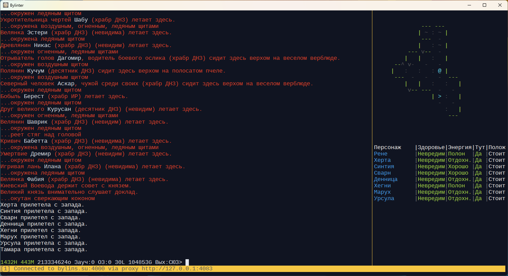

# Bylinter

Клиент для игры в MUD - текстовые онлайн игры.

- Кроссплатформенный (Windows, Linux)
- С поддержкой MCCP2, MSDP
- С широкими возможностями написания триггеров любой сложности на языке TypeScript/JavaScript
- Минималистичный настраиваемый интерфейс командной строки

Клиент в значительной степени вдохновлён опытом использования [MMC](https://haali.net/mmc/)
и является попыткой перенести похожий механизм триггеров, алиасов и биндов в современный рантайм
с типизированным языком программирования [TypeScript](https://www.typescriptlang.org/).

Сам по себе клиент является консольным приложением, которое может быть запущено в любом терминале,
однако для удобства запуска в ОС Windows в дистрибутив добавлен [WezTerm](https://wezterm.org/) -
кроссплатформенный эмулятор терминала с аппаратным ускорением, написанный на Rust. В файле его
настроек можно выбрать шрифты и любую цветовую схему из более чем тысячи, или настроить свою.

Установка Windows: скачайте bylinter-win-{ver}.7z, распакуйте, запустите bylinter.exe  
Установка Linux: скачайте bylinter-linux-{ver}.tar.xz, распакуйте, запустите run.sh  
На сервере с Linux без GUI: просто запустите bylinter-cli
